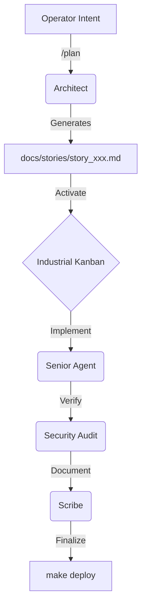

# COPERNICUS IDE // OPERATOR MANUAL [BETA v0.1.0]
══════════════════════════════════════════════════════════════════════════════
Identity: Professional Phosphor // Industrial Agentic Standard
Authority: Architect / Senior Autonomous Engineer
══════════════════════════════════════════════════════════════════════════════

## 1. THE INTERFACE PHILOSOPHY
COPERNICUS is not a general-purpose IDE; it is a **Mission Control for Autonomous Engineering**. The interface is optimized for long-duration technical sessions where visual deterministic feedback is paramount.

### 1.1 The Professional Phosphor Aesthetic
- **Midnight Background:** `#050505` (Zero-light pollution).
- **VT420 Green:** `#4ADE80` (High-contrast, low-fatigue).
- **Hairline Precision:** All panel borders are `0.5px` Steel (`#3F3F46`).
- **Scanline Integrity:** Simulated CRT scanlines on the Engine Room [F3] terminal for improved readability.

### 1.2 Zero-Gap Tiling Engine
The IDE utilizes three primary **Storyboards**, accessible via F-keys:

1.  **Blueprint [F1] // The Strategic Deck**
    - **Focus:** Kanban Pipeline, State Ledger, and Financial CapEx Tracking.
    - **Usage:** Planning features, auditing recent autonomous intents, and monitoring resource burn.

2.  **Studio [F2] // The Primary Workshop**
    - **Focus:** Explorer, Monaco Editor, and Strategic Chat.
    - **Usage:** Implementation, technical delegation, and code review.

3.  **Engine Room [F3] // The Execution Deck**
    - **Focus:** Command Deck (Makefile), Multi-PTY Terminal, and Telemetry.
    - **Usage:** Deployment, testing, and hardware-level monitoring.

---

## 2. WORKFLOW MAP: THE INDUSTRIAL PIPELINE
COPERNICUS enforces a rigid, high-fidelity engineering workflow to ensure zero-defect delivery.

### 2.1 The Handoff Loop (Heliocentric Workflow)

### 2.2 Panel Interaction Primitives
- **Command Palette [Cmd+P]:** Open the universal command palette to search files, stories, and agents.
- **Command Palette (Commands Only) [Cmd+Shift+P]:** Open the palette pre-filtered for slash commands.
- **Spotlight [Ctrl+Enter]:** Maximize the currently focused panel to full window height.
- **Flip [⌘+Shift+F]:** Flip a panel to its "Logic Side" (e.g., Strategic Chat flips to Kanban).
- **Context Injectors:** Use `@files` or `@ledger` in chat to ground the agent in reality.

---

## 3. COMMAND & CONTROL (THE NERVOUS SYSTEM)
### 3.1 Integrated Slash Commands
| Command | Description |
| :--- | :--- |
| `/plan [text]` | Initialized a new feature story with the Architect persona. |
| `/delegate agent=[ID] task="..."` | Hands context to a specialized sub-agent (Bolt, Palette, Sentinel). |
| `/forward agent=[ID]` | Forwards terminal output or linter errors to an agent for correction. |
| `/audit` | Triggers the **Sentinel** to scan staged changes for credential leaks. |
| `/pi_check` | Runs the **Performance Baseline Audit** (verified against Pi 3B+ constraints). |
| `/capex` | Generates a session-based financial capitalization report. |

### 3.2 Hardware Mapping (MacBook / Touch Bar)
- **Escape Key:** Global cancellation of agent generation.
- **Touch Bar Segment 1:** Active View Switcher (Blueprint | Studio | Engine).
- **Touch Bar Segment 2:** Active Story Timer & CapEx Burn Rate.
- **Touch Bar Segment 3:** Deployment Ignition (System Pulse).

---

## 4. TELEMETRY & COMPLIANCE
### 4.1 Deployment Strategy
`make deploy` triggers a synchronized push to the **Dell R210ii Core** server.
- **Integrity Check:** Deployment is blocked if the `/audit` has not passed in the last 15 minutes.
- **Performance Baseline:** Code that exceeds the RAM ceiling on the **Pi 3B+ Baseline** will trigger a "Performance Warning" in the Telemetry Popout.

### 4.2 State Ledger persistence
Every autonomous intent is logged to the **State Ledger** (`~/.copernicus/ledger.db`).
- **Auditing:** Use `/ledger last=5` to see the most recent system transformations.
- **Recovery:** In the event of a crash, the IDE restores state based on the last verified ledger entry.

══════════════════════════════════════════════════════════════════════════════
*COPERNICUS // FOR THE INDUSTRIAL AGENTIC OPERATOR*
