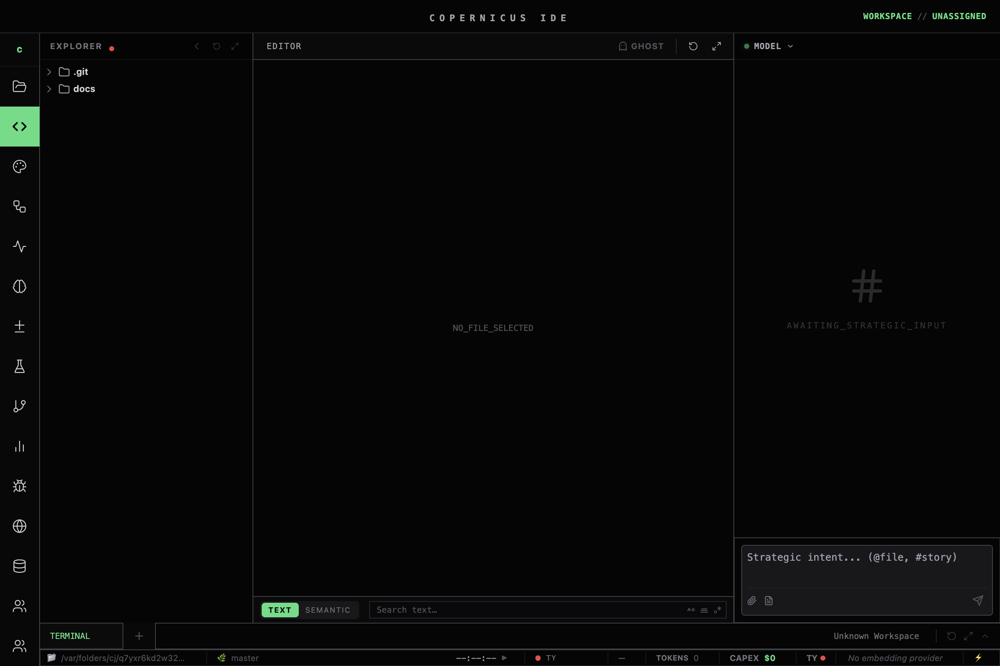
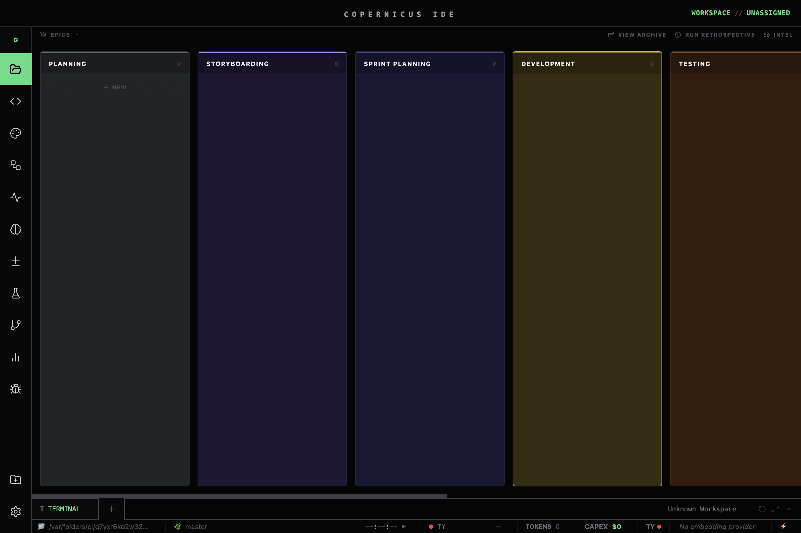
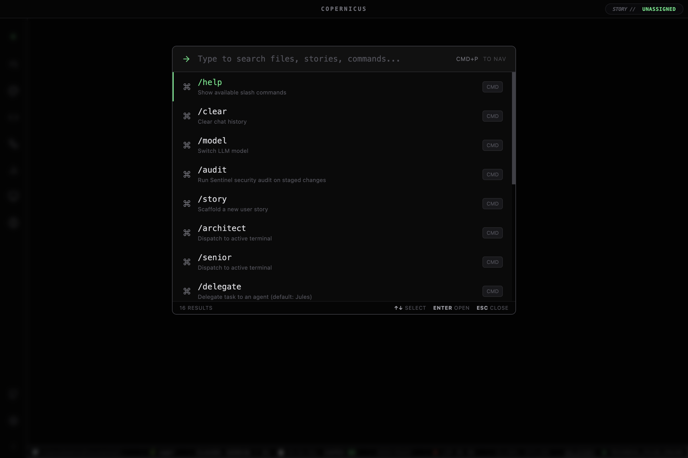
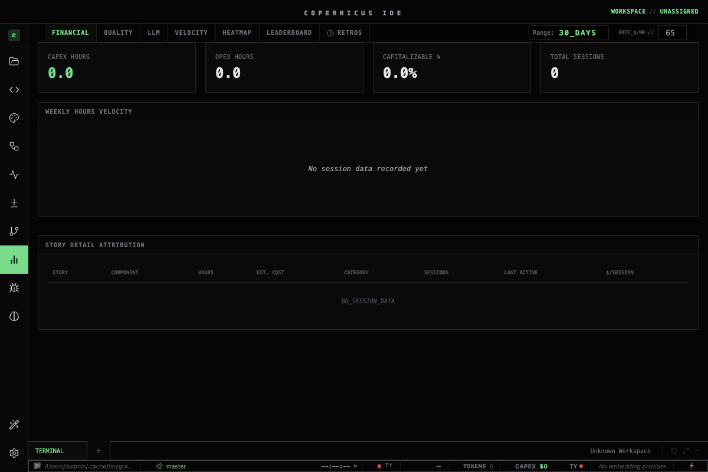
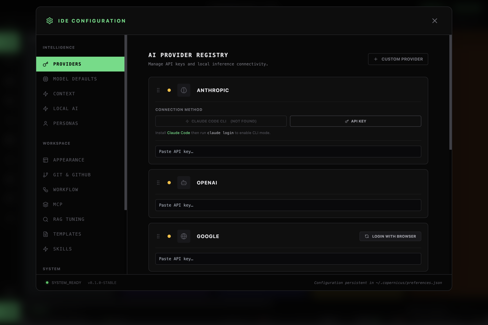

# COPERNICUS IDE — User Guide


---

## 1. Interface Overview

Copernicus uses a **zero-gap tiling engine** — panels fill the window with no gaps or padding. The layout is built around five Storyboards and an Activity Bar.

### Storyboards (F-keys)

Switch storyboards instantly with the function keys:

- **Blueprint `F1`** — Kanban pipeline, story management, CapEx summary. Your planning view.
- **Studio `F2`** — File explorer, Monaco editor, Chat panel. Where you write and delegate.
- **Engine Room `F3`** — PTY terminals, Makefile command deck, telemetry. Where you run things.
- **CapEx `F4`** — Full CapEx dashboard with burn rate charts and model cost heatmaps.
- **Workflow `F5`** — Visual workflow canvas for building multi-step agent pipelines.

### Activity Bar

The vertical icon strip on the left edge. Click any icon to jump to that storyboard or open a specific panel. The active view is highlighted.

### Panel Collapse

In 2-panel tiled views, click the vertical bookmark strip on a panel to collapse its sibling to a 40px-wide tab showing the panel label rotated vertically. Click the tab to restore. In 3-panel views, panels resize proportionally.

### Spotlight

Press `Cmd+K` to open the spotlight overlay. Type to fuzzy-search stories, files, commands, and models. Press `Enter` to navigate; `Esc` to close.

---

## 2. Chat Panel



The Chat panel lives in the right column of Studio (F2). Use it to talk to AI agents, delegate tasks, and review results.

**To send a message:** Type in the input box and press `Enter`. Use `Shift+Enter` to insert a new line without sending.

**Model picker:** Click the model name badge in the top bar to open the model picker. Select any configured provider and model. The switch takes effect on the next message.

**Context selectors:** The attachment strip lets you add structured context:
- **File** — attach a file from the current workspace
- **Story** — inject the active story's full content
- **Git** — inject recent git log

**Model hot-swap:** Switching models mid-conversation inserts a handoff divider. The new model receives a compressed summary of the prior context automatically — no manual copy-paste needed.

**Context handoff divider:** The `↔ Switched to <model>` line marks where the model changed. Content above was summarised and handed to the new model.

---

## 3. Kanban Board



The Kanban board (Blueprint F1, left panel) shows all stories organised by pipeline stage.

### Lanes

| Lane | Meaning |
|---|---|
| DRAFT | Written, not yet approved for dispatch |
| APPROVED FOR IMPLEMENTATION | Ready to dispatch to Jules or Gemini |
| IN PROGRESS | Agent is currently implementing |
| REVIEW | PR open, awaiting review gate verdict |
| COMPLETE | Merged, verified, and archived |

### Creating a Story

Press `N` with the board focused, or click the **+** button at the top of the DRAFT column. Fill in the title; Copernicus creates the story file in `docs/stories/` automatically.

### Moving Stories

Drag a card between columns, or click the card to open the story detail and change the status from the dropdown.

### Column Controls

- **Minimize** — click the minimize button on a column header to collapse to a 40px bookmark strip
- **Reorder** — drag column headers left/right to rearrange
- **Filter** — type in the filter bar above the board to filter by title, assignee, or priority

### Repo Targeting

The filter bar shows a status dot indicating whether the workspace is targeted to a git repo. An orange dot means no repo is targeted — click it to select one.

---

## 4. Monaco Editor

The Monaco editor (Studio F2, center panel) is a full-featured code editor with LSP integration.

**Opening files:** Click any file in the Explorer tree, or use `Cmd+P` to open by name.

**Multi-file tabs:** Open files appear as tabs above the editor. Click to switch; middle-click or press `✕` to close.

**LSP features (TypeScript Language Server):**
- **Completions** — appear automatically as you type; press `Ctrl+Space` to trigger manually
- **Hover** — hover over a symbol for type info and inline documentation
- **Go to definition** — press `F12` or right-click → Go to Definition
- **Diagnostics** — red underlines indicate type errors; hover to read the message

**Save:** `Ctrl+S` saves the current file. Unsaved files show a dot indicator in their tab.

**Binary and image files:** Binary files show a block screen (not editable in Monaco). Image files open in a built-in viewer with zoom controls.

---

## 5. Command Palette



Press `Cmd+P` to open the command palette. Search modes:
- **Files** — type a filename to open it instantly
- **Commands** — prefix with `>` to execute IDE commands (e.g. `>Format Document`)
- **Stories** — prefix with `#` to jump to a story card

Press `Enter` to run the selected result. Press `Esc` to close without action.

---

## 6. Agent Review Panel

When an agent (Jules or Gemini) opens a PR, the Agent Review panel appears in Blueprint view (F1, right column).

**Diff view:** Changes are syntax-highlighted. Added lines are green; removed lines are red. Modified files are listed in the sidebar.

**Run tsc:** Click **Run tsc** to trigger a TypeScript type-check against the PR branch. Zero errors is the hard gate before approval.

**Approve:** Click **Approve** to trigger the jules daemon's merge flow. The PR merges, the story status moves to COMPLETE.

**Request Rework:** Click **Request Rework** and enter your notes. The feedback is sent back to the agent as a follow-up task. The PR stays open.

---

## 7. CapEx Dashboard



The CapEx dashboard (F4 or Blueprint F1 right panel) tracks AI spend and session cost across the project.

| Tab | Shows |
|---|---|
| **Overview** | Total spend, session count, cost per story, burn rate |
| **Burn Rate** | Daily/weekly spend over time |
| **Model Heatmap** | Cost broken down by model and provider |
| **Session Log** | Per-session detail — model, tokens, cost, story attribution |
| **Export** | Download the full ledger as CSV |

**Cost per session** = `(total_hours × developer_rate) / session_count`. Set your rate in `config.env`:
```
DEVELOPER_RATE=150   # USD/hr, default 150
```

---

## 8. Settings



Open Settings from the activity bar (gear icon) or the app menu.

| Tab | What you configure |
|---|---|
| **Providers** | API keys and base URLs for each AI provider |
| **MCP Servers** | Register MCP tool servers; test connectivity |
| **Security** | Git push protection rules, secret scan config |
| **Background Services** | Register/unregister Jules daemon and backend services |
| **Git** | Default branch, repo targeting, trusted repositories |

API keys are encrypted using Electron's `safeStorage` before being written to disk. They are never stored in plain text.

---

## 9. NotebookLM

> 📌 **Pending Stories 432–433.** NotebookLM integration is not yet available in this build. Once shipped, you will be able to select a NotebookLM notebook as an AI model in the Chat panel — the notebook's sources become the model's context.
