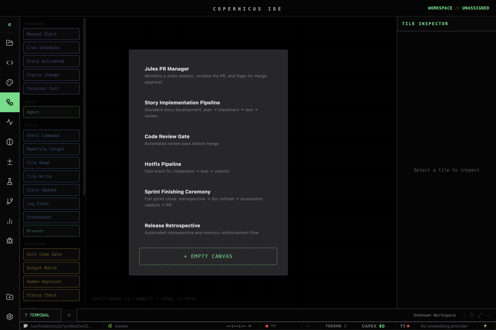

# Workflow Builder Guide

The Workflow canvas (F5) lets you build multi-step agent pipelines visually. Nodes represent individual steps; edges define execution order. A workflow run executes nodes sequentially — or in parallel wave groups — and passes context between them automatically.

---

## Core Concepts

### Nodes
The basic unit of work. Each node has a **type**, optional **variant**, and a **data** payload. When a workflow runs, each node executes in dependency order.

### Edges
Connect an output port of one node to the input port of another. Edges carry the execution flow and can also pass context values.

### Context Bag
A `Map<string, string>` carried through the entire run. Built-in variables are populated automatically; you can also set custom keys on any node output.

| Variable | Value |
|---|---|
| `{{__storyId}}` | Active story number |
| `{{__storyTitle}}` | Active story title |
| `{{__lastOutput}}` | Text output of the previous node |
| `{{__lastExitCode}}` | Exit code of the previous tool node (as string) |

Use `{{variable}}` syntax inside node prompts, commands, and condition expressions.

---

## Node Types

### Agent
Makes an AI provider call. Key fields:
- **Provider** — `anthropic`, `google`, `openai`, `openrouter`, `deepinfra`, `ollama`
- **Model ID** — e.g. `claude-sonnet-4-6`, `gemini-2.5-flash`
- **System Prompt** — static context for the model
- **Task** — the user-turn prompt; supports `{{context}}` interpolation
- **Output key** — name of the context bag key where the response is stored

### Tool
Runs a shell command. Key fields:
- **Command** — shell command string; supports `{{context}}` interpolation
- **Working directory** — defaults to repo root
- **Timeout** — seconds before the node is marked failed

### Decision
Branches execution based on the previous node's output. Key fields:
- **Condition** — a pattern matched against `{{__lastOutput}}`
- **True branch** — edge followed when condition matches
- **False branch** — edge followed when it doesn't

The losing branch's subtree is marked `skipped` and shown in the canvas with a muted style.

### Trigger
The workflow entry point. Defines what starts the run:
- **Manual** — user clicks Run
- **Story status change** — fires when a story reaches a configured status
- **Schedule** — cron expression (remote CCR triggers only)

### Flow
A sequencing node with no logic of its own. Use it to fan-out to parallel branches or merge multiple inputs back to one path.

---

## Building Your First Workflow

This walkthrough creates a 3-node pipeline: `agent → decision → tool`.

**Step 1 — Open the canvas**
Press `F5` or click the Workflow icon in the activity bar.

**Step 2 — Add a Trigger node**
Press `N` to add a node. Select **Trigger** → **Manual**. This is the entry point.

**Step 3 — Add an Agent node**
Press `N` again, select **Agent**. Set:
- Provider: `anthropic`
- Model: `claude-haiku-4-5-20251001` (fast and cheap for evaluation)
- Task: `Review the following diff and respond with APPROVED or BLOCKED:\n{{__lastOutput}}`
- Output key: `review_verdict`

Connect the Trigger output to the Agent input by dragging between the ports.

**Step 4 — Add a Decision node**
Press `N`, select **Decision**. Set:
- Condition: `APPROVED`

Connect the Agent output to the Decision input.

**Step 5 — Add a Tool node**
Press `N`, select **Tool**. Set:
- Command: `gh pr merge {{prNumber}} --merge`

Connect the Decision **true** output to the Tool input.

**Step 6 — Run it**
Click **Run** in the toolbar or press `R` with the canvas focused. Watch nodes highlight as they execute. Check the **Engine Room** (F3) terminal for tool output.

---

## Built-in Templates

Access templates from the toolbar dropdown "Templates".

### Jules PR Manager
Polls Jules sessions, reviews PRs with an Agent node, and merges on APPROVE. The reference implementation for the review gate pattern.

### Story Implementation Pipeline
Trigger → Agent (plan) → Decision (plan approved?) → Tool (dispatch to Jules/Gemini) → Agent (review diff). Full story lifecycle in one workflow.

### Code Review Gate
Agent reads a diff from `{{__lastOutput}}`, classifies it as APPROVE / REQUEST_CHANGES / BLOCK, and routes accordingly. Drop this into any pipeline that needs a quality gate.

### Hotfix Pipeline
Fast path: Trigger (story status → IN PROGRESS) → Tool (git checkout -b hotfix) → Tool (run tests) → Decision (tests pass?) → Tool (open PR). Skips planning step entirely.

### Release Retrospective
Trigger (story count threshold) → Agent (synthesise retro from work log) → Tool (write to docs/retrospectives/) → Agent (extract action items). Pairs with the Retrospective tab.

---

## Context Variables Reference

| Variable | Type | Set by |
|---|---|---|
| `{{__storyId}}` | string | Trigger (from active story) |
| `{{__storyTitle}}` | string | Trigger (from active story) |
| `{{__lastOutput}}` | string | Previous node output |
| `{{__lastExitCode}}` | string | Previous Tool node exit code |

To add a custom variable, set the **Output key** on any Agent or Tool node. The value is the node's full text output.

---

## Time-Travel / Rewind

Every node execution creates a **snapshot** of the context bag. To rewind:

1. Click the **Rewind** button in the toolbar (clock icon)
2. Select the snapshot to restore to
3. The canvas enters **detached state** — node states reset to the snapshot point

> ⚠️ **Detached HEAD warning:** In detached state, running the workflow again branches from the snapshot. The original run history is preserved but you're no longer on the "live" branch. Click **Resume latest** to return to the current run without re-executing.

---

## Troubleshooting

**Node stuck in `running`**
The agent or tool is taking longer than expected. Check the Engine Room terminal (F3) for live output. If the node is truly hung, click **Stop** in the toolbar to abort the run. If it's an agent node, the provider API may be rate-limiting — check your API key tier.

**Decision node not branching**
The condition is case-sensitive and matches the full `{{__lastOutput}}` content, not a substring. If your agent responds with `"APPROVED: looks good"` and your condition is `APPROVED`, it won't match. Use a more specific prompt instruction like "Respond with only the word APPROVED or BLOCKED."

**Agent node returns empty output**
Usually a context injection problem — the `{{variable}}` key doesn't exist in the context bag yet. Check that the upstream node sets an output key that matches what you're referencing. Open the **Context Inspector** (right panel when a node is selected) to see the current bag state.
