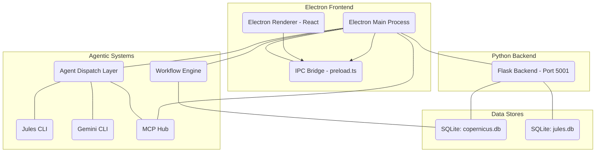

# ARCHITECTURE.md — Developer Documentation Suite

This document provides a high-level overview of the Copernicus IDE's architecture, including its core components, data flow, database structure, process lifecycle, and agent dispatch mechanisms.

## 1. Component Diagram

## 2. Data Flow: Chat Message

The journey of a chat message from the renderer to a Language Model (LLM) provider and back:

1.  **Renderer (`ChatPanel`)**: The user types a message in the `ChatPanel`.
2.  **`ipcRenderer.invoke('chat:send')`**: The message is sent from the renderer to the main process via an IPC invoke call.
3.  **`preload.ts`**: The IPC call passes through the `contextBridge` defined in `preload.ts`, which validates and forwards it to the main process.
4.  **`ipcMain`**: The Electron main process's `ipcMain` receives the `chat:send` event.
5.  **`ChatHandler`**: A dedicated `ChatHandler` (or similar component within the main process) processes the incoming chat message.
6.  **`LLMService`**: The `ChatHandler` delegates the request to the `LLMService`, which is responsible for interacting with various LLM providers.
7.  **Provider API**: The `LLMService` forwards the chat message to the configured LLM provider's API (e.g., Anthropic, Google, OpenAI).
8.  **Stream Chunks Back**: As the LLM provider generates a response, it streams chunks back to the Electron main process. The main process then uses `win.webContents.send('chat:chunk')` to push these chunks to the renderer.
9.  **Renderer Updates**: The renderer receives the `chat:chunk` events and incrementally updates the chat interface to display the LLM's response.

## 3. Database Layout

Copernicus primarily uses SQLite databases for persistent storage, located in the application's data directory.

-   **`copernicus.db`**: Stores core application state and telemetry.
    *   `state_ledger`: Tracks overall application state changes.
    *   `model_calls`: Logs every LLM interaction, including cost, tokens, and provider.
    *   `context_snapshots`: Stores snapshots of agent context for session continuity.
    *   `project_memory`: Stores learnings and insights extracted from retrospectives.
    *   ... (other application-specific tables)
-   **`jules.db`**: Manages Jules agent session information.
    *   `jules_sessions`: Stores details about active and completed Jules sessions.
    *   `review_state`: Tracks the review status of Jules-generated PRs.

**Platform Data Directory Paths**:
-   **macOS**: `~/Library/Application Support/copernicus/`
-   **Linux**: `~/.config/copernicus/`
-   **Windows**: `%APPDATA%/copernicus/`

## 4. Process Lifecycle

Copernicus manages several processes to provide its full functionality:

-   **Electron Launch**: Upon launching the Copernicus IDE, the following components are initiated:
    *   **Electron Main Process**: The core Node.js process managing the application window, IPC, and system integrations.
    *   **Electron Renderer Process (React)**: The web-based UI that users interact with.
    *   **OTel Sidecar**: An OpenTelemetry sidecar process for application performance monitoring and tracing.
    *   **Workflow Engine**: Initiated to manage and execute agentic workflows.
-   **Persistent Services (Post-524/525/527)**: Following recent architectural enhancements, several services are designed to run persistently as background services (e.g., via `launchd` on macOS or `systemd` on Linux), even if the Electron application is closed:
    *   **`jules-daemon`**: (from `scripts/jules_daemon.py`) Polls for active Jules sessions, reviews PRs, and handles auto-merges.
    *   **Flask Backend**: Provides the core API for agent orchestration, data management, and integration with external services.
    *   **MCP Hub**: The Codebase Memory Platform hub, providing semantic search and code intelligence.
-   **On Quit**: The Electron main and renderer processes, along with any directly managed child processes (like the OTel sidecar), will terminate. Persistent services (daemon, Flask, MCP hub) will continue to run in the background.

## 5. Agent Dispatch Matrix

Copernicus leverages different agent dispatch mechanisms based on the nature of the task:

| Agent | Task Type | Key Characteristics | Usage Scenario |
| :---- | :-------- | :------------------ | :------------- |
| **Jules** | TypeScript/React single-concern stories | Asynchronous, generates a GitHub PR for review. | Implementing specific UI features, bug fixes in frontend code. |
| **Gemini** | Python/shell/docs stories, multi-file refactors | Synchronous PTY session, direct file system access, background "yolo" mode. | Developing backend features, writing documentation, shell scripting, complex multi-file changes. |

**When to use each**:
-   **Use Jules** for isolated frontend or TypeScript-heavy tasks that benefit from a PR-based review cycle.
-   **Use Gemini** for backend Python development, shell script creation, documentation updates, or larger refactoring efforts that require direct, real-time interaction and immediate file system modifications.
